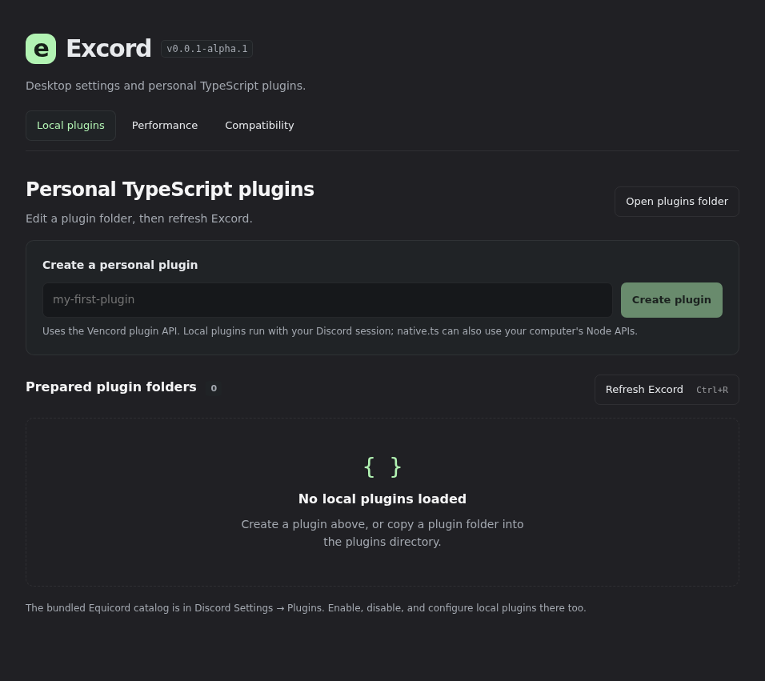
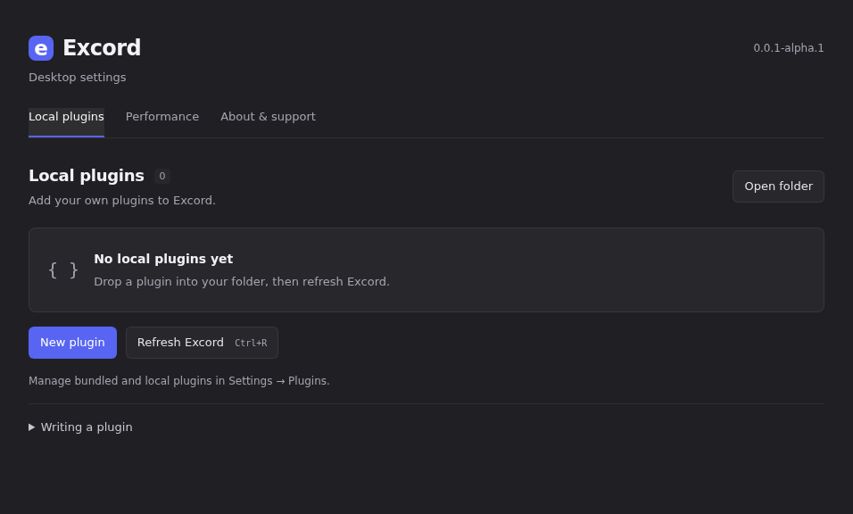
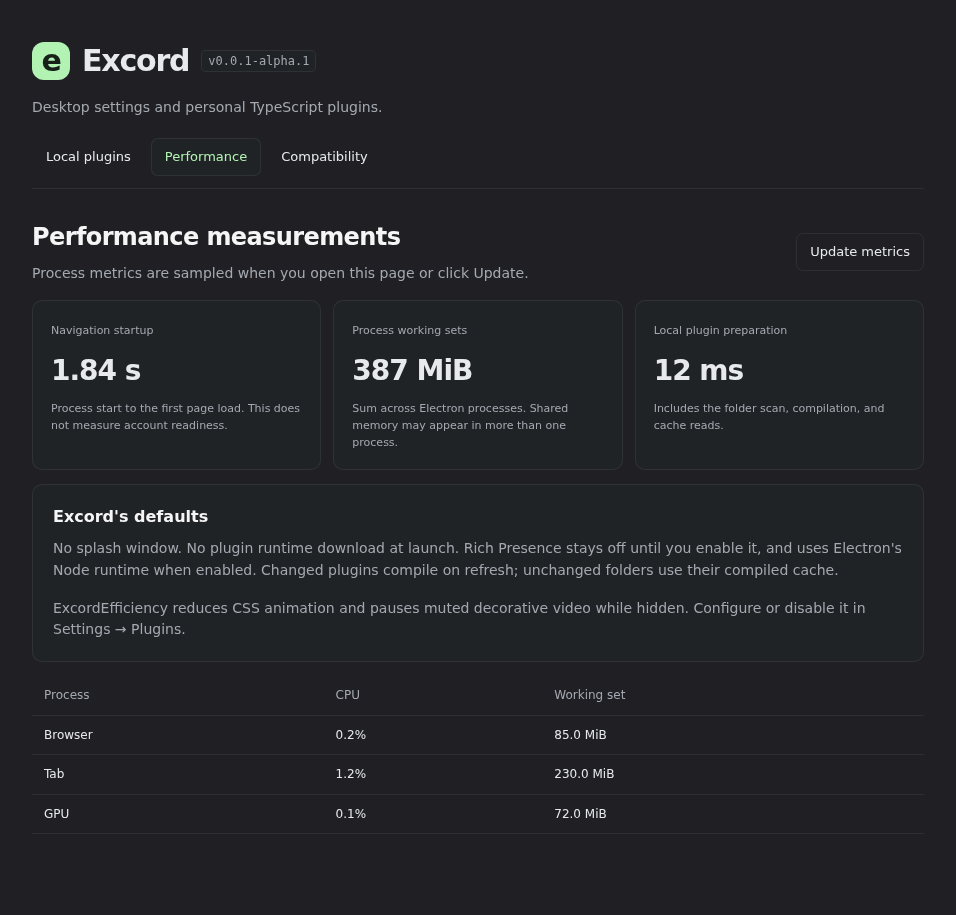
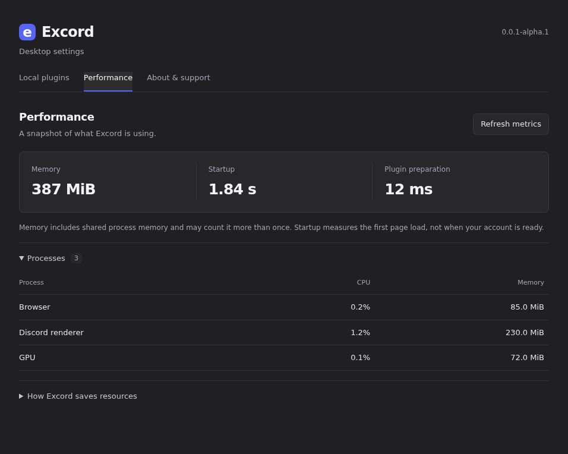
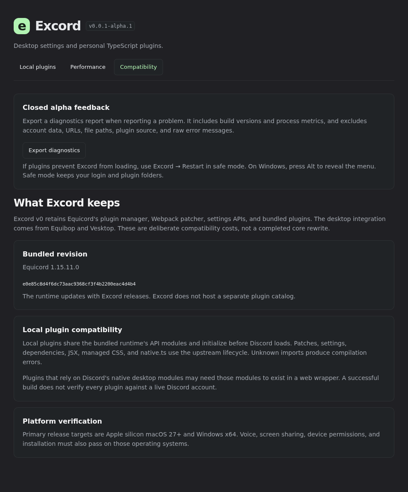
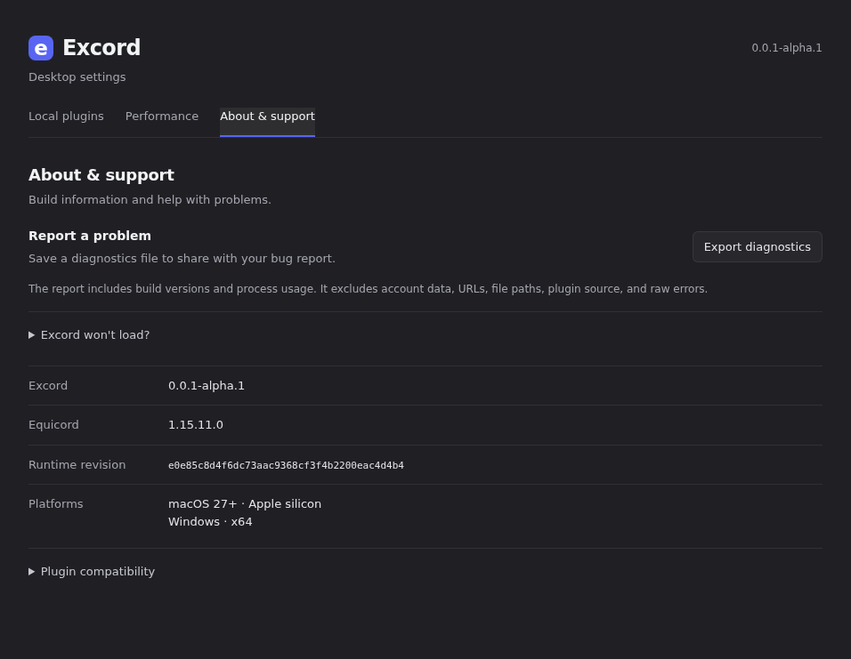

# Settings redesign

The three Excord tabs use compact rows, a single metrics strip, and expandable help. Plugin creation appears on demand. The existing folder, create, refresh, diagnostics, and metrics actions remain available. The inherited desktop settings below these tabs remain available too.

Screenshots show the real component with sample data, without a Discord account. The HTML fixture blocks network access with a Content Security Policy; the browser also aborts HTTP(S). They demonstrate layout and local interactions, not signed-in Discord behavior.

| Tab | Before | After |
| --- | --- | --- |
| Local plugins |  |  |
| Performance |  |  |
| About & support |  |  |

To reproduce from the repository root, with the Playwright Chromium browser installed:

```sh
mkdir -p test-results/settings
bun run scripts/preview-control.mts --revision d692392 --output test-results/settings/before.html
bun run scripts/preview-control.mts --output test-results/settings/after.html
node --import tsx scripts/settings-capture.mts before
node --import tsx scripts/settings-capture.mts after
```

Set `EXCORD_SCREENSHOT_BROWSER` to use an existing Chromium executable. The after check also creates a sample plugin, retries a failed diagnostics read, and checks every tab at 390px with a 64-character plugin name. These are fixture operations only.
